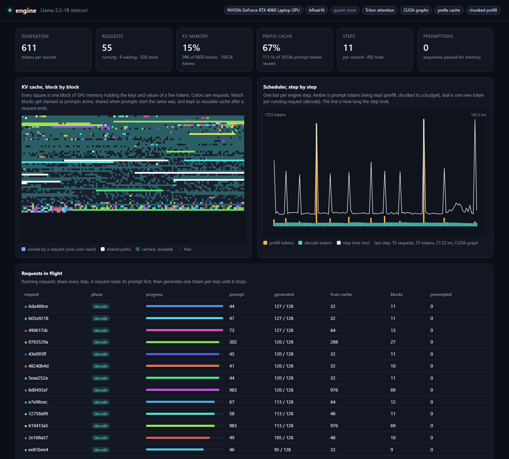
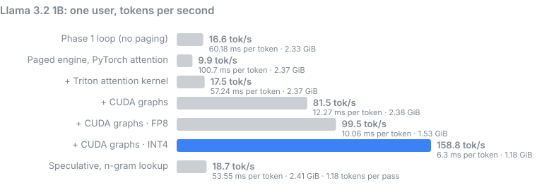
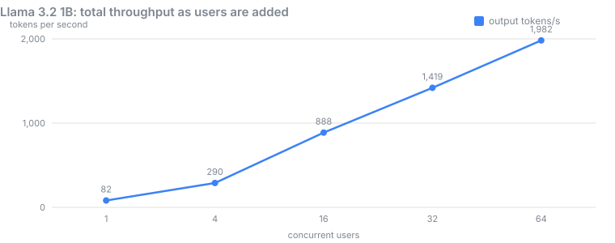
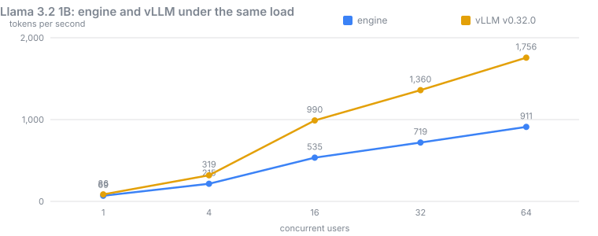

# engine

**A large language model server, built from scratch, that you can watch think.**

`engine` takes a Llama model and serves it to many people at once through the same API
as OpenAI, so any OpenAI client or SDK works with it unchanged. It is the same kind of
software as vLLM or Hugging Face TGI, the layer that sits between a model's weights and
every chat app built on top of them, written from first principles to run on a laptop
with an 8 GB GPU.

What makes it different is that nothing is hidden. Open `/dashboard` while it runs and
you see the GPU's memory being handed out block by block, requests joining and leaving
the batch on every step, prompts sharing memory because they start with the same words,
and the scheduler pausing a request when memory runs out. And every speed trick in it is
tested for correctness: the model must pick the same words as Hugging Face's reference
implementation on 200 test prompts, and the batched, paged, cached engine must produce
exactly the same tokens as a plain one-request loop.



*The live dashboard during a 64-user run: 55 requests generating in the same steps, 67%
of prompt tokens served from the prefix cache, nothing paused for memory. In the step
chart, flat teal steps are CUDA-graph replays; the tall amber spikes are steps where
several waiting prompts are read together (prompt coalescing, below).*

**Results:** every gate, every benchmark and every chart is in [RESULTS.md](RESULTS.md),
with the headline numbers [below](#results).

## Why this exists

Running a language model for one person is easy: load the weights, feed in the prompt,
pick the next word, repeat. Serving it to hundreds of people at once on one GPU is a
different problem, and almost none of it is about the model. It is about memory and
scheduling.

**The memory problem.** To avoid recomputing the whole conversation for every new word,
a model keeps the *keys and values* of every past token in GPU memory: the KV cache. For
Llama 3.2 3B that is 112 KB per token, so one 8,000-token conversation needs about 900
MB. A simple server reserves the maximum length for every request up front, and most of
that memory sits empty. Fewer requests fit, and the expensive GPU idles.

**The scheduling problem.** Generating text is one word at a time, and each step for a
single request barely uses the GPU. The way to go fast is to run many requests in the
same step. But requests arrive at random times, have different lengths and finish at
different moments. If the server waits for a whole batch to finish before starting new
ones, short answers wait behind long ones and the GPU idles again.

**The cost problem.** Each generated word requires reading every model weight from
memory once. For a 3 billion parameter model in 16-bit numbers that is 6 GB of reading
per word. Speed is capped by memory bandwidth, not math.

Production servers solve these with a handful of well-known techniques. This project
builds every one of them by hand, explains each one, and shows them working live.

## What it does

| Problem | Technique in `engine` | Effect |
| --- | --- | --- |
| KV memory wasted on reserved space | **Paged KV cache**: memory in 16-token blocks, handed out as needed | Waste limited to one partly filled block per request |
| Same system prompt recomputed for every user | **Prefix caching**: blocks named by a hash of their content and shared | Repeated prompt prefixes cost nothing after the first time |
| GPU idle between requests | **Continuous batching**: requests join and leave on every step | The batch is always as full as memory allows |
| One long prompt freezes everyone | **Chunked prefill**: long prompts are read in slices alongside other work | Steady speed for running requests |
| Memory runs out mid-generation | **Preemption**: pause the newest request, free its memory, resume it later | No crashes, no out-of-memory errors |
| Attention reads scattered memory | **Triton paged attention kernel**: reads keys and values straight from the blocks | No copying into a contiguous buffer |
| Thousands of tiny GPU launches per word | **CUDA graphs**: each decode step recorded once and replayed | Python and launch overhead removed |
| New prompts knock every step off the fast path | **Prompt coalescing**: newcomers wait a few steps and are read together, all chunks in one FlashAttention varlen call | 64-user throughput from 52% to 77% of vLLM |
| Weights too big or too slow to read | **INT4 and FP8 weights**: 4-bit or 8-bit weights unpacked inside the matmul | Llama 3B: 6.2 GiB to 2.4 GiB, 2.8x faster |
| One word per weight read | **Speculative decoding**: guess several words cheaply, check them all at once | Several words per pass, same output distribution |
| Clients expect OpenAI | **OpenAI-compatible API** with streaming, cancellation, timeouts and load shedding | Works with existing tools |
| Servers are black boxes | **Live dashboard** and Prometheus metrics | Every decision visible |
| You cannot see why the model chose a word | **Token confidence**: OpenAI `logprobs` and `top_logprobs`, drawn in the playground | Every token tinted by certainty, alternatives on hover |

## See it work

```bash
engine serve --model models/Llama-3.2-1B-Instruct
# open http://127.0.0.1:8000/dashboard
```

The dashboard has four live panels:

- **KV cache, block by block.** Every square is one block of GPU memory. Each request
  gets its own color. White squares are shared by several requests that started with
  the same prompt. Dark teal squares belong to finished requests and are kept as a cache
  in case the same prefix comes back.
- **Scheduler, step by step.** One bar per engine step: amber for prompt tokens being
  read, teal for new tokens being generated, a line for how long the step took.
- **Requests in flight.** Each request's phase, progress, how much of its prompt came
  from the cache, and how many times it was paused for memory.
- **Playground.** Send a prompt and watch the answer stream in, each token tinted by how
  sure the model was (green sure, red unsure); hover a token to see the other words it
  considered. Or press **Flood** to fire 16 requests that share a long system prompt and
  watch batching and prefix caching happen in the panels above.

## How it works

One request, from HTTP to text:

```
client  -->  FastAPI (engine/server/api.py)
               validates the request, applies the chat template, streams the reply
                |
                v
             AsyncEngine (engine/server/async_engine.py)
               one background thread owns the GPU; HTTP handlers never touch it
                |
                v
             LLMEngine.step()  (engine/runtime/engine.py), in a loop:
               1. Scheduler     which requests run this step, and how many tokens each
               2. BlockManager  hands out KV blocks, finds shared prefixes
               3. model         one forward pass over every request's new tokens
               4. sampler       picks each request's next token
               5. output        turns tokens into text, checks stop rules
                |
                v
client  <--  server-sent events, one chunk per token
```

**The step.** The engine runs in steps. In each step the scheduler gathers the next
tokens of every running request (one token for a request that is generating, a slice of
the prompt for one that is still reading), flattens them into a single sequence, and runs
the model once. A step might hold 40 requests generating plus a 300-token chunk of a new
prompt.

**Paged memory.** The KV cache is one large array of slots, split into blocks of 16
tokens. Each request owns a *block table*: the list of blocks that hold its tokens, in
order, anywhere in memory. Token `i` lives in block `table[i // 16]`, slot `i % 16`. A
request grows one block at a time, so nothing is reserved that is not used. This is the
idea behind vLLM's PagedAttention, the same trick an operating system uses for virtual
memory.

**Sharing prefixes.** When a block fills up, it gets a name: a hash of its 16 tokens
combined with the name of the block before it. Two requests that start with the same
words produce the same chain of names, so the second request simply points at the first
request's blocks and skips that part of the computation. When the last owner finishes, a
named block is not erased. It stays findable until the memory is needed, oldest first.

**Attention over pages.** Generating a token means comparing it against every earlier
token's keys. The Triton kernel in `engine/kernels/paged_attention.py` runs one GPU
program per request and attention head, walks the request's block table, and reads keys
and values directly from wherever the blocks are, computing the softmax as it goes.

**Fewer launches.** A generation step for a small model is mostly overhead: hundreds of
tiny GPU kernel launches driven from Python. The engine records each step once per batch
size as a CUDA graph and replays it, so a whole forward pass becomes one launch.

**Smaller weights.** With `--quantization int4`, each weight matrix is stored as 4-bit
numbers with a scale and offset for every group of 128. The GPU kernel unpacks them
inside the matrix multiply, so a quarter of the bytes cross the memory bus. On Llama
3.2 3B that takes peak memory from 6.2 GiB to 2.4 GiB and speed from 28 to 78 tokens per
second. The same arithmetic says Llama 3.1 8B (15 GB in 16-bit) fits an 8 GB card in
INT4; `engine info` prints the estimate, but 8B has not been benchmarked here yet.

**Guess and check.** Speculative decoding (`engine/runtime/speculative.py`) lets a cheap
proposer (a small draft model, or a lookup that finds the current phrase earlier in the
text) guess the next few tokens. The big model checks all guesses in one pass, which
costs about the same as generating one token. A mathematically exact accept/reject rule
keeps the output distribution identical to the big model alone.

Full design notes: [docs/architecture.md](docs/architecture.md).

## How we know it is correct

Speed tricks are easy to get subtly wrong: a block written to the wrong slot, a request
reading another request's memory, an off-by-one in a position. So each optimization is
tested for **identical output** against something simpler.

| What | Checked against |
| --- | --- |
| The model itself | Hugging Face's Llama with the same weights: logits match to 1e-4 |
| Model and sampler, real Llama 3.2 1B | Hugging Face `generate` on 200 prompts, 128 tokens each, FP32: every token identical (Gate 1) |
| Real Llama 3.2 3B in BF16 | Same 200 prompts; any difference must be a near-tie (top two choices within 0.01) |
| Paged cache, batching, chunking, preemption, prefix caching | The simple one-request loop, token for token, plus ~200 randomly generated workloads with arrivals, cancellations and tiny memory |
| Mixed steps on the GPU (kernel decode rows plus prompt chunks) | The simple one-request loop, with staggered arrivals, chunking and prefix hits |
| Batching on the real model | Each prompt run alone, in FP32: 128 of 128 batched requests identical |
| Block allocator | Leak and double-free checks after every operation and every engine step |
| Triton kernel | A plain PyTorch implementation, 12 shapes and dtypes |
| CUDA graphs | The same engine without graphs |
| Speculative decoding | Plain greedy (exact), and a chi-square test on 10,000 samples for sampling |
| HTTP API | The engine called directly; streamed text equals non-streamed text |

```bash
pytest                       # 99 CPU tests, about 40 seconds
pytest -m gpu                # 24 GPU tests: Triton kernel, varlen, CUDA graphs, INT4, FP8
ENGINE_MODEL_DIR=models/Llama-3.2-1B-Instruct pytest -m slow     # the 200-prompt gate
```

Building it this way caught real bugs: a batch losing track of rows when one request
finished mid-step, a deadlock where a waiting request held memory needed by the one in
front of it, and a CUDA graph reading memory that had been freed after capture. The
benchmarks caught one more: when a long prompt shared a step with many generating
requests, attention padded every request to the prompt's length. With 24 requests and a
4,000-token chunk that is gigabytes of scratch memory per layer, enough to push the GPU
into system RAM and trip Windows' 2-second GPU watchdog. Each prompt chunk now gets its
own attention call and generating requests go through the Triton kernel, so memory grows
with the tokens actually present.

## Results

Measured on one **RTX 4060 Laptop GPU (8 GB)**, Windows 11, PyTorch 2.15, CUDA 13.2, on
6 and 7 November 2026. The full report with every table and chart is
**[RESULTS.md](RESULTS.md)** (also as a standalone page,
[docs/results.html](docs/results.html)); every number comes from a JSON file in
[`bench/results/`](bench/results) and can be regenerated with `python bench/run_all.py`.

### The gates

| Gate | Result | What happened |
| --- | --- | --- |
| **1. Same answers as Hugging Face**, Llama 3.2 1B, FP32 | ✅ **pass** | 200 of 200 prompts identical: 18,894 tokens, not one differs |
| **1. Same answers as Hugging Face**, Llama 3.2 3B, BF16 | ❌ **fail, 195 / 200** | 181 identical, 14 near-ties; 5 split where the top two choices were 0.125 apart (see below) |
| **2. 64 users for 30 minutes** | ❌ **fail, as written** | 25,818 requests at 1,347 tokens/s: 0 errors, 0 out-of-memory, 0 preemptions, all KV memory returned. Fails only on its strictest check: 159 prompts got a different greedy answer on a repeat (see below) |
| **3. 70% of vLLM's throughput** | ✅ **pass, 77%** | 1,360 vs 1,757 tokens/s at 64 users against vLLM v0.32.0 on the same GPU (73% in an earlier sweep); it started at 52% (see below) |
| Unit and property tests (CPU) | ✅ pass | 99 passed in 36 s |
| GPU tests (Triton kernel, CUDA graphs, INT4, FP8, varlen) | ✅ pass | 24 passed in 27 s |

**About the 5 failures on 3B.** At each one, Hugging Face's own top two candidate tokens
were exactly 0.125 apart. That is one BF16 rounding step for logits of this size, the
smallest difference BF16 can represent there, so the two implementations each rounded a
coin flip differently. All five are long prompts (850 to 1,950 tokens), where rounding
has the most steps to add up. The gate's rule asked for a gap under 0.01, which BF16
cannot express at this scale, so it is reported as a failure, as written. The 1B run in
FP32, where rounding is 65,000 times finer, matches every token.

### One user: how fast does a reply stream?

Llama 3.2 1B, one request, 256 generated tokens. Each row adds one technique.

| Engine | Tokens/s | ms per token | GPU memory |
| --- | ---: | ---: | ---: |
| Phase 1 loop (contiguous cache, plain PyTorch) | 16.6 | 60.2 | 2.33 GiB |
| Paged cache, PyTorch attention | 9.9 | 100.7 | 2.37 GiB |
| + Triton paged attention kernel | 17.5 | 57.2 | 2.37 GiB |
| + CUDA graphs | **81.5** | 12.3 | 2.38 GiB |
| + FP8 weights | 99.5 | 10.1 | 1.53 GiB |
| + INT4 weights | **158.8** | 6.3 | 1.18 GiB |



Llama 3.2 3B: 9.8 tokens/s in the Phase 1 loop, **27.8** with CUDA graphs, 46.2 with
FP8 and **78.2 with INT4** (2.44 GiB instead of 6.2 GiB).

The paged cache on its own is *slower* than the simple loop, because the reference path
copies each request's keys and values out of the blocks before attention. The Triton
kernel removes that copy, and CUDA graphs remove the Python and launch overhead, which is
most of the cost for a model this small: 5x on its own.

### Many users at once

The real server (`engine serve`, 1B, BF16) with N clients that each stream chat
completions back to back for 60 seconds.

| Users | Tokens/s | Requests/s | First token, median | First token, p99 | Per token, median | Errors |
| ---: | ---: | ---: | ---: | ---: | ---: | ---: |
| 1 | 71 | 0.8 | 96 ms | 339 ms | 13 ms | 0 |
| 4 | 210 | 2.3 | 114 ms | 352 ms | 15 ms | 0 |
| 16 | 534 | 5.5 | 143 ms | 626 ms | 20 ms | 0 |
| 32 | 889 | 9.1 | 213 ms | 522 ms | 25 ms | 0 |
| 64 | **1,360** | 14.3 | 389 ms | 677 ms | 35 ms | 0 |
| 64, for 30 minutes (Gate 2) | 1,347 | 14.3 | 400 ms | 703 ms | 36 ms | 0 |



Throughput grows 19x from 1 to 64 users while each user's stream slows only from 13 to
35 ms per token, still about 29 tokens per second each, faster than anyone reads. Zero errors and zero preemptions at every level, and all KV memory
returned at the end of every run.

### Against vLLM (Gate 3)

The same load test against **vLLM v0.32.0**, the most widely used open source LLM server,
in Docker on the same laptop GPU: same model (Llama 3.2 1B, BF16), same 64-sequence
limit, vLLM's defaults otherwise (FlashAttention, `torch.compile`, CUDA graphs, prefix
caching, chunked prefill).

| Users | engine tok/s | vLLM tok/s | engine / vLLM | First token p50, engine / vLLM | Per token p50, engine / vLLM |
| ---: | ---: | ---: | ---: | ---: | ---: |
| 1 | 71 | 86 | **83%** | 96 / 31 ms | 12.8 / 10.7 ms |
| 4 | 210 | 319 | 66% | 114 / 50 ms | 15.0 / 11.3 ms |
| 16 | 534 | 990 | 54% | 143 / 88 ms | 20.3 / 12.2 ms |
| 32 | 889 | 1,360 | 65% | 213 / 168 ms | 25.4 / 13.9 ms |
| 64 | **1,360** | 1,757 | **77%** | **389 / 414 ms** | 34.9 / 19.8 ms |



The gate asks for 70% at 64 users: the engine reaches **77%**, and 73% in an earlier sweep
under the same conditions, so it **passes**. It did not at first: the first run reached
52% (911 tokens/s). Profiling one step at a time showed why, and two changes fixed it.

**1. Prompt coalescing.** With 64 users, someone finishes almost every other step and
the next request arrives. Reading even a few prompt tokens forces the whole step off the
CUDA graph onto the eager path, and on this machine an eager step costs about 85 ms
however small it is (it is bound by launching ~700 small GPU operations from Python),
against 20 ms for a graph step. So 41% of steps were eager and took 77% of the time. Now
a new prompt may wait up to one step per 8 running requests (8 steps at 64 users, about
150 ms) and is read together with whoever else arrived. Eager steps fell to 10%.

**2. One attention call for all prompt chunks.** The eager steps that remain now read
several prompts at once, and attention handled them one chunk at a time in every layer.
They now go through a single FlashAttention variable-length call
(`torch.nn.attention.varlen`) per layer, which took an eager step from 195 to 88 ms.

| Step | 64-user throughput, engine alone (no HTTP) |
| --- | ---: |
| Before | 941 tokens/s |
| + prompt coalescing | 1,170 tokens/s |
| + one varlen attention call | **1,588 tokens/s** |

The cost is a little latency at the start: first-token p50 at 64 users went from 247 to
389 ms, still level with vLLM's 414. Coalescing only holds prompts when requests are
decoding on CUDA graphs and switches itself off at 8 or fewer users;
`--no-prefill-coalescing` turns it off entirely. The FP32 batching test below still
gives 128 of 128 identical answers with both changes in.

vLLM is still about twice as fast per step at low load (12 against 20 ms at 16 users):
it compiles the whole model into fused kernels with `torch.compile`, where the engine
still launches each small operation separately and builds every step's batch in Python.

### Batching changes rounding, not math

Under load, a greedy prompt sent twice can come back with a different answer. That would
be a serious bug if the engine mixed up requests, so it gets its own test
(`bench/batch_invariance.py`): 64 prompts, each run alone, then all of them twice over
in batches of up to 64 with prompts arriving mid-flight and the prefix cache on.

| Precision | Loaded requests | Same tokens as running alone | Different | Largest top-2 gap where they split |
| --- | ---: | ---: | ---: | ---: |
| FP32 | 128 | **128** | 0 | |
| BF16 | 128 | 62 | 66 | 0.25 |

In FP32 every token matches, so batching, paging and caching compute exactly the right
thing. In BF16 half the answers drift, and every drift starts at a token where the
model's top two choices were within 0.25 of each other (zero to two BF16 rounding steps):
a different batch size changes the order numbers are added in, and that rounds a coin
flip the other way. vLLM does exactly the same: in the Gate 3 runs it returned a
different greedy answer on repeat for 117 prompts at 64 users. Gate 2's
strict "same answer every time" rule cannot pass in BF16 for that reason, so it is
reported as failed rather than relaxed after the fact.

### Quality: what do smaller weights cost?

Perplexity on WikiText-2 (lower is better).

| Model | BF16 | FP8 | INT4 (groups of 128) |
| --- | ---: | ---: | ---: |
| Llama 3.2 1B | 13.17, 2.62 GiB | 13.33 (+0.16), 1.71 GiB | 15.84 (+2.67), 1.29 GiB |
| Llama 3.2 3B | 11.05, 6.31 GiB | 11.14 (+0.09), 3.68 GiB | 12.01 (+0.96), 2.45 GiB |

FP8 is close to free. INT4 costs more, and costs the small model the most; INT4 3B is
both smaller and better than BF16 1B (12.01 vs 13.17, 2.45 vs 2.62 GiB).

### What did not work (yet)

- **Speculative decoding is correct but slower here.** It passes the exactness and
  chi-square tests, and a 1B draft gets 56% of its guesses accepted on 3B. But the
  verify pass runs without CUDA graphs, so on 3B it reaches 10.2 tokens/s against 27.8
  for plain decoding with graphs. Capturing the verify step in a graph is the next step.
- **Long prompts on 3B in BF16** read at 685 tokens/s for 2,000 tokens against 3,650 for
  512: the 6.2 GiB model leaves too little of the 8 GB card for long-prompt activations.
  INT4 or FP8 fixes this.
- **Repeat answers under load** differ in BF16 (above). Making BF16 batch-invariant
  needs kernels that add in a fixed order whatever the batch size, at some cost in
  speed.
- **Two gates fail as written**: Gate 1 on 3B and Gate 2, both only on BF16 rounding
  ties. Their rules should measure gaps in BF16 rounding steps rather than a fixed 0.01.
- **vLLM is still ahead at 4 to 32 users** (54 to 66%). Next: fuse the small per-layer
  operations (norm, rotary, activation) so eager steps launch fewer kernels, and build
  each step's batch on the GPU instead of in Python lists.

## Quickstart

You need Python 3.11+, an NVIDIA GPU (compute capability 8.0 or newer) and Linux, WSL2
or Windows.

```bash
git clone https://github.com/AashutoshR/inference-engine && cd inference-engine
python -m venv .venv && source .venv/bin/activate     # Windows: .venv\Scripts\activate
pip install -e ".[dev,serve,eval]"
pip install --force-reinstall torch --index-url https://download.pytorch.org/whl/cu132
pip install triton-windows                             # Windows only
```

Download a model (`--source unsloth` uses ungated copies of Meta's weights, so no
Hugging Face login is needed):

```bash
python scripts/download_models.py --source unsloth             # Llama 3.2 1B
python scripts/download_models.py --source unsloth --also 3b   # and 3B
```

Serve it and talk to it with the OpenAI SDK:

```bash
engine serve --model models/Llama-3.2-1B-Instruct
```

```python
from openai import OpenAI

client = OpenAI(base_url="http://127.0.0.1:8000/v1", api_key="unused")
reply = client.chat.completions.create(
    model="Llama-3.2-1B-Instruct",
    messages=[{"role": "user", "content": "What is a KV cache?"}],
    stream=True,
)
for chunk in reply:
    print(chunk.choices[0].delta.content or "", end="")
```

Or run it in Docker:

```bash
docker build -t engine .
docker run --gpus all -p 8000:8000 -v "$PWD/models:/models" engine --model /models/Llama-3.2-1B-Instruct
```

### Useful options

| Option | Default | What it does |
| --- | --- | --- |
| `--quantization int4` / `fp8` | none | Smaller, faster weights (FP8 needs an RTX 40xx or newer) |
| `--max-num-seqs` | 64 | Requests that can run in the same step |
| `--max-num-batched-tokens` | 4096 | Token budget per step; long prompts are chunked to fit |
| `--max-waiting` | 256 | Queue length before new requests get HTTP 429 |
| `--timeout` | 600 | Seconds before a request is cancelled |
| `--gpu-memory-utilization` | 0.9 | Share of GPU memory the KV cache may use |
| `--no-prefix-caching`, `--no-chunked-prefill`, `--no-cuda-graphs` | | Turn a feature off to see what it was worth |

API: `POST /v1/chat/completions` and `POST /v1/completions` (streaming or not),
`GET /v1/models`, `GET /dashboard`, `GET /debug/state`, `GET /metrics`, `GET /health`.
Beyond OpenAI's fields it accepts `top_k`, `min_p` and `repetition_penalty`.

Other tools:

```bash
engine info --model models/Llama-3.1-8B-Instruct --gpu-mem 8   # will it fit, and how
engine generate --model models/Llama-3.2-1B-Instruct --prompt "Hello"
python bench/bench_decode.py --model M --mode graphs           # single-request speed
python bench/load_test.py --concurrency 64 --duration 60       # many users at once
python bench/perplexity.py --model M --quant int4              # does quantization hurt quality?
```

## What is inside

```
engine/
  model/        the Llama network in plain PyTorch, plus a loader that can quantize on the fly
  runtime/      the engine: scheduler, block manager, paged cache, CUDA graphs, sampler,
                speculative decoding, and the original one-request loop kept as a test oracle
  kernels/      the Triton paged-attention kernel
  quant/        INT4 and FP8 linear layers
  server/       the OpenAI-compatible API, the background engine thread, the dashboard
tests/          unit, property, GPU and golden tests
bench/          speed, load, soak and perplexity benchmarks; results/ holds the numbers
docs/           architecture notes
scripts/        model download, test-prompt builder
```

About 3,100 lines of Python and Triton, plus a 400-line dashboard. No vLLM, no FlashInfer, no custom C++: PyTorch,
Triton and the standard library.

## Status

Built in five phases, each closed by a measurable gate:

1. **Correct baseline.** Own forward pass and sampler. Gate: identical to Hugging Face on 200 prompts. *Passed for 1B in FP32 (200/200); 3B in BF16 at 195/200, the 5 being one-rounding-step ties.*
2. **Serving core.** Paged cache, continuous batching, Triton kernel, OpenAI API. Gate: 64 concurrent streams for 30 minutes with no errors or leaks. *Ran: 0 errors, 0 leaks, 1,347 tokens/s; fails only the strict repeat-answer check, which BF16 rounding breaks.*
3. **Throughput and latency.** Chunked prefill, prefix caching, preemption, CUDA graphs, prompt coalescing. Gate: 70% of vLLM's throughput on the same GPU. *Passed: 77% of vLLM v0.32.0 at 64 users (52% before profiling).*
4. **Quantization and speculation.** INT4, FP8, speculative decoding.
5. **Hardening.** Load and soak tests, metrics, dashboard, Docker, docs.

Model weights are under Meta's Llama license.
