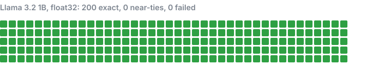
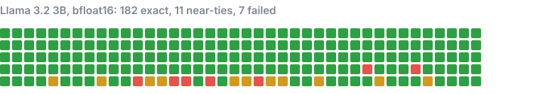
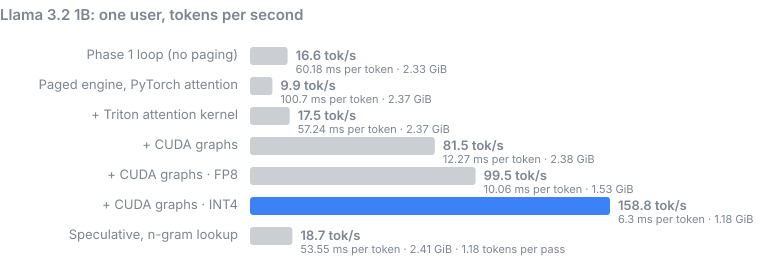
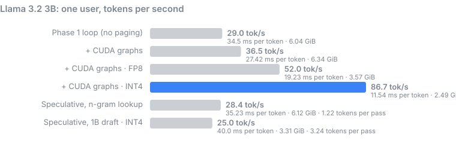
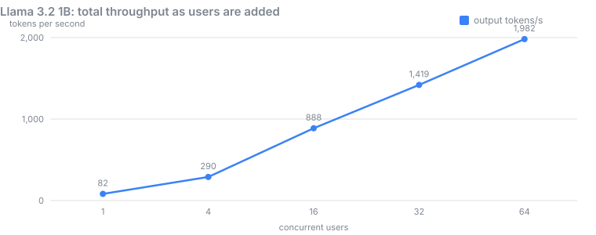
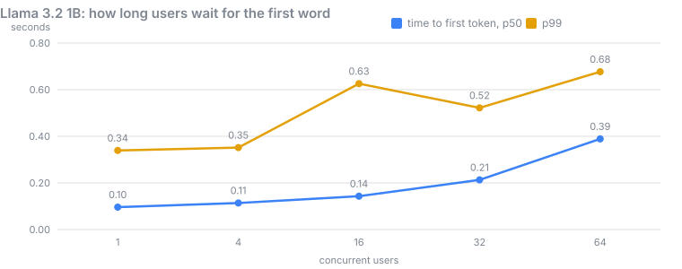
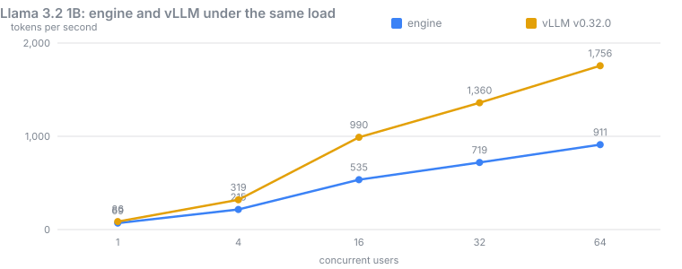
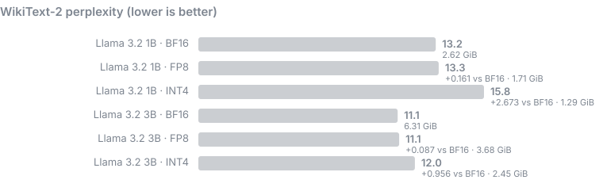

# Results

Measured on **NVIDIA GeForce RTX 4060 Laptop GPU** (8.0 GiB), PyTorch 2.15.0+cu132, CUDA 13.2, 2026-11-07. Every number here comes from a JSON file in [`bench/results/`](bench/results), produced by `python bench/run_all.py` and drawn by `python bench/report.py`.

A browsable version of this page: [`docs/results.html`](docs/results.html).

## Gates

| Check | Result | Detail |
| --- | --- | --- |
| Gate 1 · 1B FP32 exact | ✅ pass | 200 exact, 0 near-ties, 0 failed of 200 |
| Gate 1 · 3B BF16 near-tie | ❌ fail | 181 exact, 14 near-ties, 5 failed of 200 |
| Gate 2 · 64 streams soak | ❌ fail | 30 min, 25,818 requests, 0 errors, KV left in use 0%, repeat answers differed: 159 prompts; of 89 measured, 87 split where the top two choices were within 0.25 (largest gap 1.5) |
| Gate 3 · 70% of vLLM | ✅ pass | 77% of vLLM at 64 users: 1,360 vs 1,756 tokens/s |
| Unit tests (CPU) | ✅ pass | 99 passed, 0 failed, 36.3 s |
| GPU tests | ✅ pass | 24 passed, 0 failed, 27.1 s |

## Headline numbers

| | | |
| --- | --- | --- |
| One user, 1B | **159 tok/s** | 9.6x the Phase 1 loop |
| Many users, 1B | **1,360 tok/s** | 64 concurrent streams |
| Matches Hugging Face | **395 / 400** | prompts, 38,136 tokens compared |
| INT4 quality cost, 3B | **+0.96** | perplexity, 6.31 to 2.45 GiB |

## Correctness: identical output to Hugging Face

Each square is one of the 200 test prompts. The engine and Hugging Face both generate 128 tokens greedily; green means every token matched. In BF16, amber marks a prompt where the two picked different tokens at a point where the model's top two choices were within 0.01 of each other (a coin flip that rounding can decide); anything else would be red.





**Llama-3.2-3B-Instruct bfloat16: the 5 failed prompts.** Where the two implementations first chose a different token, and how far apart Hugging Face's top two logits were there.

| prompt | prompt tokens | diverged at token | top-2 logit gap |
| --- | ---: | ---: | ---: |
| long-15 | 851 | 7 | 0.125 |
| long-26 | 1231 | 117 | 0.125 |
| long-32 | 1337 | 100 | 0.125 |
| long-42 | 1656 | 50 | 0.125 |
| long-46 | 1949 | 93 | 0.125 |

Every gap is exactly 0.125. That is one BF16 rounding step for logits between 16 and 32: the closest two different values BF16 can hold there. So these are ties at BF16 precision that the 0.01 rule cannot see, because BF16 cannot express a gap that small. They all come from long prompts (850 to 1,950 tokens), where rounding has the most steps to accumulate. The gate is reported as failed, as written; the fix is to compare FP32 logits or to measure the gap in BF16 steps.

## One user: how fast does a single reply stream?

Each bar adds one technique on top of the one above it. Batch size 1, a 128-token prompt, 256 generated tokens, greedy, median of three runs.



| Variant | Tokens/s | ms per token | Peak GPU memory |
| --- | ---: | ---: | ---: |
| Phase 1 loop (no paging) | 16.6 | 60.18 | 2.33 GiB |
| Paged engine, PyTorch attention | 9.9 | 100.7 | 2.37 GiB |
| + Triton attention kernel | 17.5 | 57.24 | 2.37 GiB |
| + CUDA graphs | 81.5 | 12.27 | 2.38 GiB |
| + CUDA graphs · FP8 | 99.5 | 10.06 | 1.53 GiB |
| + CUDA graphs · INT4 | 158.8 | 6.3 | 1.18 GiB |
| Speculative, n-gram lookup | 18.7 | 53.55 | 2.41 GiB |



| Variant | Tokens/s | ms per token | Peak GPU memory |
| --- | ---: | ---: | ---: |
| Phase 1 loop (no paging) | 9.8 | 102.34 | 6.04 GiB |
| + CUDA graphs | 27.8 | 35.98 | 6.2 GiB |
| + CUDA graphs · FP8 | 46.2 | 21.64 | 3.57 GiB |
| + CUDA graphs · INT4 | 78.2 | 12.79 | 2.44 GiB |
| Speculative, n-gram lookup | 9.0 | 110.6 | 6.12 GiB |
| Speculative, 1B draft · INT4 | 10.2 | 98.39 | 3.31 GiB |

## Many users: what happens as load grows?

The real server (`engine serve`, 1B, BF16) under N clients that each stream chat completions back to back for 60 seconds, 128 tokens per reply.





| Users | Output tok/s | Requests/s | TTFT p50 | TTFT p99 | ITL p50 | ITL p99 | Errors | Preemptions | Repeat answers differed |
| ---: | ---: | ---: | ---: | ---: | ---: | ---: | ---: | ---: | --- |
| 1 | 71 | 0.76 | 96 ms | 339 ms | 12.8 ms | 15.5 ms | 0 | 0 | 1 prompt |
| 4 | 210 | 2.29 | 114 ms | 352 ms | 15.0 ms | 86.0 ms | 0 | 0 | 9 prompts; of 6 measured, 6 split where the top two choices were within 0.25 (largest gap 0.125) |
| 16 | 534 | 5.47 | 143 ms | 626 ms | 20.3 ms | 101.1 ms | 0 | 0 | 49 prompts; of 29 measured, 28 split where the top two choices were within 0.25 (largest gap 3.625) |
| 32 | 889 | 9.13 | 213 ms | 522 ms | 25.4 ms | 103.8 ms | 0 | 0 | 78 prompts; of 48 measured, 48 split where the top two choices were within 0.25 (largest gap 0.25) |
| 64 | 1,360 | 14.25 | 389 ms | 677 ms | 34.9 ms | 125.9 ms | 0 | 0 | 111 prompts; of 64 measured, 59 split where the top two choices were within 0.25 (largest gap 2.5) |

**Soak (Gate 2):** 64 streams for 30 minutes, 25,818 requests, 1,347 tokens/s, 0 errors, repeat answers differed: 159 prompts; of 89 measured, 87 split where the top two choices were within 0.25 (largest gap 1.5), KV memory in use at the end: 0%.

## Against vLLM (Gate 3)

Gate 3 runs the same load test against vLLM v0.32.0, the most widely used open source LLM server, in Docker on the same GPU, same model (Llama 3.2 1B, BF16), same 64-sequence limit, with its defaults otherwise (prefix caching, chunked prefill and CUDA graphs on). The gate: 70% of vLLM's throughput at 64 users.



| users | engine tok/s | vLLM tok/s | engine / vLLM | first token p50, engine | first token p50, vLLM | per token p50, engine | per token p50, vLLM | repeat answers differed, vLLM |
| --- | ---: | ---: | ---: | ---: | ---: | ---: | ---: | ---: |
| 1 | 71 | 86 | 83% | 96 ms | 31 ms | 12.8 ms | 10.7 ms | 2 prompts |
| 4 | 210 | 319 | 66% | 114 ms | 50 ms | 15.0 ms | 11.3 ms | 20 prompts; of 12 measured, 12 split where the top two choices were within 0.25 (largest gap 0.125) |
| 16 | 534 | 990 | 54% | 143 ms | 88 ms | 20.3 ms | 12.2 ms | 83 prompts; of 58 measured, 56 split where the top two choices were within 0.25 (largest gap 3.875) |
| 32 | 889 | 1,360 | 65% | 213 ms | 168 ms | 25.4 ms | 13.9 ms | 90 prompts; of 58 measured, 55 split where the top two choices were within 0.25 (largest gap 3.875) |
| 64 | 1,360 | 1,756 | 77% | 389 ms | 414 ms | 34.9 ms | 19.8 ms | 117 prompts; of 71 measured, 70 split where the top two choices were within 0.25 (largest gap 3.875) |

## Batching changes rounding, not math

Under load, the same greedy prompt can come back with a different answer. Is that a bug or rounding? bench/batch_invariance.py runs 64 prompts through the engine on the GPU two ways: alone, one at a time with the prefix cache off, and loaded, all of them twice over with one new arrival per step, mixed prompt-and-decode steps and the prefix cache on. If batching or caching changed the math, FP32 would show it; if it only changes rounding, FP32 (65,000 times finer than BF16) should match almost everywhere.

| weights | loaded requests | largest batch | identical | differed | largest top-2 gap at a split |
| --- | ---: | ---: | ---: | ---: | ---: |
| float32 | 128 | 64 | 128 | 0 |  |
| bfloat16 | 128 | 64 | 62 | 66 | 0.25 |

## Quality: does quantization hurt?

Perplexity on the WikiText-2 test set (about 290,000 tokens, 2,048-token windows). Lower is better; the gap to BF16 is the price of smaller weights.



| model | weights | perplexity | vs BF16 | peak GPU memory |
| --- | --- | ---: | ---: | ---: |
| Llama 3.2 1B | BF16 | 13.17 |  | 2.62 GiB |
| Llama 3.2 1B | FP8 | 13.33 | +0.16 | 1.71 GiB |
| Llama 3.2 1B | INT4, groups of 128 | 15.84 | +2.67 | 1.29 GiB |
| Llama 3.2 3B | BF16 | 11.05 |  | 6.31 GiB |
| Llama 3.2 3B | FP8 | 11.14 | +0.09 | 3.68 GiB |
| Llama 3.2 3B | INT4, groups of 128 | 12.01 | +0.96 | 2.45 GiB |

## Reading prompts (prefill)

| Model | 512-token prompt | 2,000-token prompt | Peak memory |
| --- | ---: | ---: | ---: |
| Llama 3.2 1B | 8,452 tok/s | 10,825 tok/s | 2.42 GiB |
| Llama 3.2 3B | 3,650 tok/s | 685 tok/s | 6.12 GiB |

## Reproduce

```bash
python bench/run_all.py      # about two hours
python bench/report.py       # rebuilds this page
```
